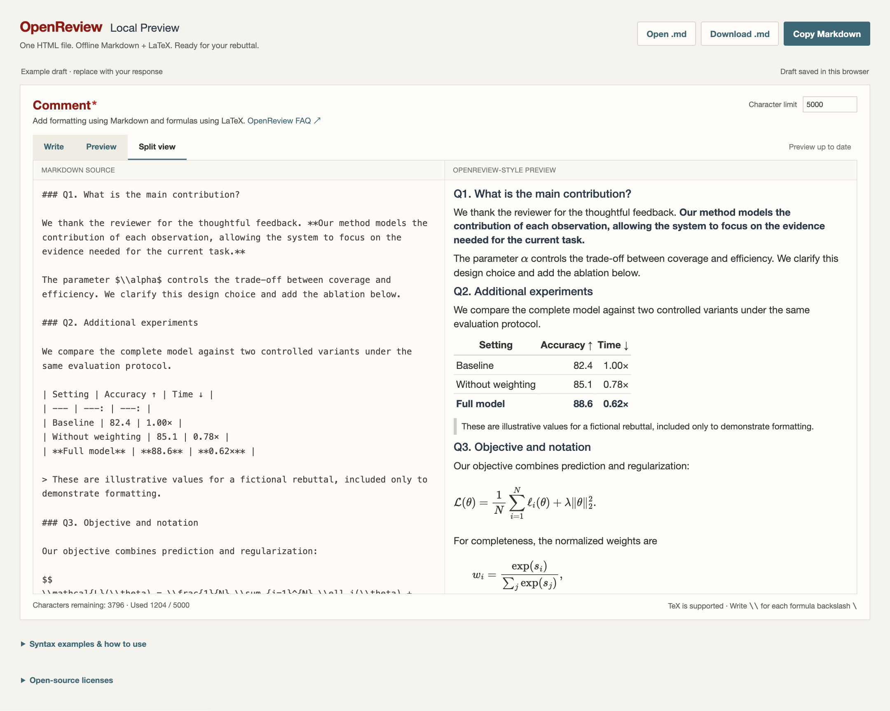
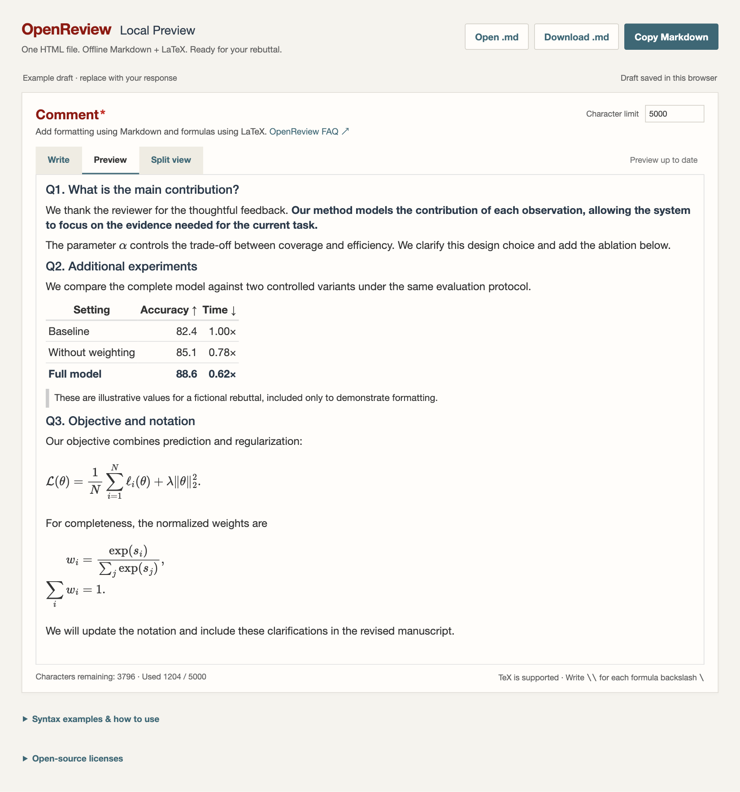

<div align="center">

# OpenReview Local Preview

**Preview your rebuttal before you post it.**

A local Markdown + LaTeX editor, packaged into a single HTML file.

[](https://github.com/CYandYue/Openreview-Preview/blob/main/OpenReview-standalone.html)


[](LICENSE)

**English** · [简体中文](README.zh-CN.md)

[Download the app](https://github.com/CYandYue/Openreview-Preview/blob/main/OpenReview-standalone.html) · [See an example](docs/examples/rebuttal.md) · [Report an issue](https://github.com/CYandYue/Openreview-Preview/issues)

</div>



Writing a rebuttal in a regular Markdown editor can hide formatting differences that only appear after pasting into OpenReview. This tool follows OpenReview's **Markdown → HTML sanitization → MathJax** pipeline, so you can check your final source while you write.

## Start in three steps

1. **[Open the file page](https://github.com/CYandYue/Openreview-Preview/blob/main/OpenReview-standalone.html)** and click **Download raw file** (the ↓ button) to save `OpenReview-standalone.html`.
2. **Open it in your browser.** Chrome or Edge is recommended. No installation or server is needed.
3. **Write, preview, and copy.** Paste your rebuttal or open a `.md` file, then use **Copy Markdown** to move the source into OpenReview.

The standalone file is about **2 MB**. Scripts, styles, the formula engine, the safe extension, and math fonts are embedded. You can keep it on your laptop or send that one file to a coauthor.

If you prefer Git, clone this repository and open `OpenReview-standalone.html`. No GitHub Release is required.

## Repository layout

```text
OpenReview-standalone.html   The complete app — download this file
source/                     Editable source, dependencies, builder and tests
docs/                       Screenshots, example Markdown and third-party notices
README.md / README.zh-CN.md  Usage guides
LICENSE                     AGPL-3.0-only
```

For source changes and development commands, see the [developer guide](source/README.md).

## Made for the rebuttal workflow

| Feature | What it does |
| --- | --- |
| **Live split view** | Edit source on the left and see formatted text and formulas on the right. |
| **Write / Preview** | Switch to source-only or preview-only mode when you want more space. |
| **OpenReview rendering rules** | Uses Marked, DOMPurify, and MathJax with adapted OpenReview configuration. |
| **Character budget** | Counts the source, including markup and formulas. The default 5000-character limit is editable. |
| **Local files** | Import `.md` or `.txt`, copy the exact source, and download a Markdown file. |
| **Browser drafts** | Restores your draft on the same browser and page address. ⌘/Ctrl + S downloads a file copy. |
| **Follow external edits** | In supported browsers, preview changes saved from VS Code or another editor. Typing in the page pauses following. |
| **Offline use** | The standalone app loads its runtime assets locally and has no draft-upload backend or analytics. |

## Give the rendered text room

Use **Preview** to check headings, emphasis, tables, and multi-line equations together.



Screenshots use the [fictional example](docs/examples/rebuttal.md); the reported numbers are only formatting samples.

## The backslash detail that matters

In a **Markdown-enabled OpenReview field**, formula backslashes need escaping before Markdown passes the text to MathJax. Enter the source you intend to paste into OpenReview:

```markdown
### Q1. Motivation

**Key point.** The parameter $\\alpha$ controls the trade-off.

$$
\\mathcal{L} = \\frac{1}{N} \\sum_{i=1}^{N} \\ell_i.
$$

$$
\\begin{aligned}
a &= b+c \\\\
d &= e+f
\\end{aligned}
$$
```

Use `$...$` for inline math and `$$...$$` for display math. A LaTeX line break needs **four backslashes** in this Markdown source. The app preserves your source when copying or downloading; it does not add escaping for you.

The [official TeX support guide](https://docs.openreview.net/reference/openreview-tex/openreview-tex-support) explains the rules, including underscore conflicts and supported math commands.

## A few practical details

- **Preview compatibility:** this is an independent tool, not an official OpenReview product. The renderer follows the referenced frontend configuration; fonts, widths, venue settings, and later site changes can still differ. Check the official Preview before submitting.
- **Saving:** browser storage is tied to the browser and page address. Download `.md` for a durable backup. Opening a file reads it; edits in the page do not automatically overwrite the original.
- **Sharing:** sending the HTML shares the editor. Send an exported `.md` as well if you want to share your writing.
- **Counting:** the counter uses `text.trim().length`, matching the legacy editor this tool was modeled on. Set the limit for your actual venue; the official form is authoritative.
- **File following:** support depends on the browser's File System Access API and permissions. Ordinary file import remains available. If necessary, serve the folder on localhost with `python3 -m http.server 8765 --bind 127.0.0.1`.

## Build and contribute

All development files live in [`source/`](source/README.md). The developer guide covers editing the source version, rebuilding the single-file app, running offline browser checks, and refreshing screenshots. Python 3.9+ is used for builds; Node.js 20+ is used for development checks.

Bug reports and small, focused pull requests are welcome. For rendering issues, include a minimal Markdown example and your browser version.

## License and acknowledgments

**[AGPL-3.0-only](LICENSE).** Rendering behavior and configuration are adapted from the [OpenReview web frontend](https://github.com/openreview/openreview-web). Marked, DOMPurify, MathJax, and their respective licenses are retained; see [third-party notices](docs/THIRD_PARTY_NOTICES.md).

Created by [CYandYue](https://github.com/CYandYue).
