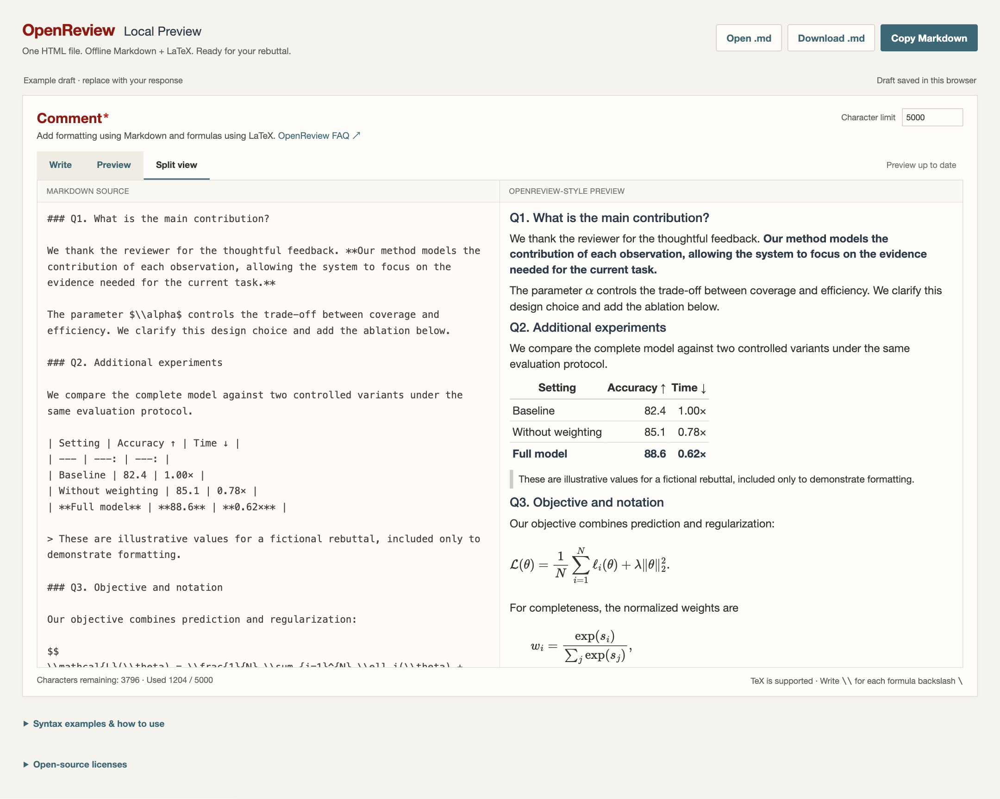
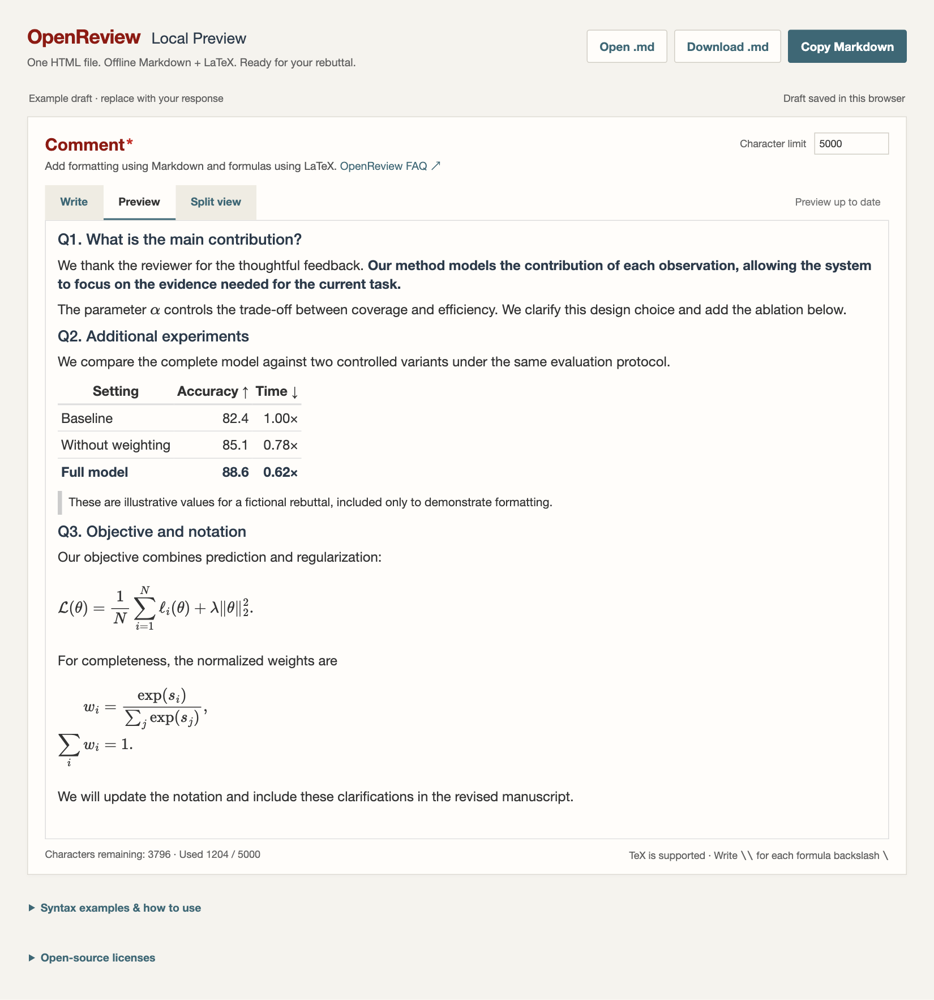

<div align="center">

# OpenReview Local Preview

**在提交之前，把 rebuttal 的排版看清楚。**

一个 HTML 文件，在本地实时预览 Markdown 和 LaTeX。

[](https://github.com/CYandYue/Openreview-Preview/blob/main/OpenReview-standalone.html)


[](LICENSE)

[English](README.md) · **简体中文**

[下载单文件版](https://github.com/CYandYue/Openreview-Preview/blob/main/OpenReview-standalone.html) · [查看写作示例](docs/examples/rebuttal.md) · [反馈问题](https://github.com/CYandYue/Openreview-Preview/issues)

</div>



在普通 Markdown 编辑器里显示正常的文字，粘贴到 OpenReview 后可能出现公式转义、换行和排版差异。这个工具参考 OpenReview 的 **Markdown → HTML 清理 → MathJax** 渲染顺序，让你在本地检查最终要提交的原文。

## 三步开始

1. **[打开文件页面](https://github.com/CYandYue/Openreview-Preview/blob/main/OpenReview-standalone.html)**，点击 **Download raw file**（↓ 下载按钮），保存 `OpenReview-standalone.html`。
2. **用浏览器打开。** 推荐 Chrome 或 Edge，无需安装，也不用启动服务器。
3. **编辑、预览、复制。** 粘贴 rebuttal 或打开 `.md` 文件，确认格式后点击 **Copy Markdown**，再粘贴到 OpenReview。

文件约 **2 MB**，已经内嵌脚本、样式、公式引擎、safe 扩展和数学字体。留在电脑里随时用，发给合作者也只需要这一个文件。

如果习惯 Git，也可以克隆完整仓库后打开 `OpenReview-standalone.html`。下载和使用均不需要发布 GitHub Release。

## 仓库结构

```text
OpenReview-standalone.html   完整可用的工具，下载这一个文件即可
source/                     源码、依赖、构建脚本和开发检查
docs/                       截图、Markdown 示例和第三方组件说明
README.md / README.zh-CN.md  使用说明
LICENSE                     AGPL-3.0-only 许可证
```

需要修改源码或重新构建时，可查看[开发指南](source/README.md)。

## 为 rebuttal 写作准备的功能

| 功能 | 用途 |
| --- | --- |
| **左右实时预览** | 左边修改原文，右边查看文字、表格和公式。 |
| **Write / Preview** | 需要更多空间时，切换到纯编辑或纯预览视图。 |
| **参考 OpenReview 的解析规则** | 使用 Marked、DOMPurify 和 MathJax，并适配官方配置。 |
| **字符预算** | 统计含 Markdown 标记与公式的原文，默认上限 5000，可按实际字段修改。 |
| **本地文件** | 导入 `.md` / `.txt`，复制原文或下载 Markdown 文件。 |
| **浏览器草稿** | 在同一浏览器、同一页面地址恢复草稿；⌘/Ctrl + S 可下载文件。 |
| **跟随外部编辑** | 支持的浏览器可自动预览 VS Code 等编辑器保存的修改；在网页输入时会暂停跟随。 |
| **离线使用** | 单文件版的运行依赖已内嵌，没有上传草稿的后端或分析统计脚本。 |

## 专心检查最终呈现

切换到 **Preview**，一起检查标题、加粗、表格和多行公式的效果。



截图使用[虚构的写作示例](docs/examples/rebuttal.md)，数值仅用于演示格式。

## 反斜杠是容易踩坑的地方

在 **开启 Markdown 的 OpenReview 字段**中，公式反斜杠需要转义。请直接写最终要粘贴到 OpenReview 的原文：

```markdown
### Q1. Motivation

**Key point.** The parameter $\\alpha$ controls the trade-off.

$$
\\mathcal{L} = \\frac{1}{N} \\sum_{i=1}^{N} \\ell_i.
$$

$$
\\begin{aligned}
a &= b+c \\\\
d &= e+f
\\end{aligned}
$$
```

行内公式用 `$...$`，独立公式用 `$$...$$`。LaTeX 换行在 Markdown 原文中需要写 **四个反斜杠**。复制和下载会保留输入内容，工具不会自动添加转义。

下划线冲突、数学命令支持等细节，可参考 [OpenReview 官方 TeX 说明](https://docs.openreview.net/reference/openreview-tex/openreview-tex-support)。

## 使用时的几个细节

- **兼容范围：**这是独立工具，并非 OpenReview 官方产品。解析配置参考官方前端，但字体、页面宽度、venue 配置和后续网站更新仍可能带来差异，提交前请在官方 Preview 再核对一次。
- **草稿保存：**浏览器草稿与浏览器、页面地址相关。需要长期保存时请下载 `.md`；网页中的修改不会自动覆盖原文件。
- **分享方式：**发送 HTML 分享的是编辑器。如果还想分享正文，请一并发送导出的 `.md`。
- **字符统计：**使用 `text.trim().length`，参考此工具最初仿照的旧版编辑器；实际限制和计数以会议表单为准。
- **跟随文件：**依赖浏览器的 File System Access API 及权限；普通文件导入仍可用。必要时可以在项目目录执行 `python3 -m http.server 8765 --bind 127.0.0.1`，通过 localhost 打开。

## 构建与贡献

所有开发文件集中在 [`source/`](source/README.md)，开发指南中包含源码版使用、单文件构建、离线浏览器检查和截图更新步骤。构建需要 Python 3.9+，开发检查需要 Node.js 20+。

欢迎反馈问题或提交范围明确的 PR。遇到渲染问题时，请附上最小 Markdown 示例和浏览器版本。

## 许可证与致谢

采用 **[AGPL-3.0-only](LICENSE)**，部分渲染行为和配置参考 [OpenReview 官方前端](https://github.com/openreview/openreview-web)。Marked、DOMPurify、MathJax 保留各自许可证，详见[第三方组件说明](docs/THIRD_PARTY_NOTICES.md)。

作者：[CYandYue](https://github.com/CYandYue)。
